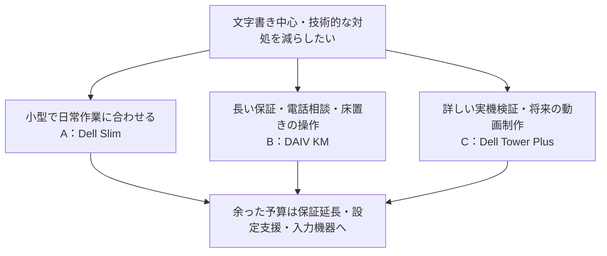

# 仕事用PC比較 — 使い勝手と安心の根拠で選ぶ

調査日：2026-10-14（日本時間）。価格は税込、ポイント還元を差し引かない表示額です。

**まず比較するなら、文字書き中心の用途にはDell Slim、保証期間と本体の使いやすさにはDAIV、実機検証の詳しさにはDell Tower Plusです。** 高価格だから故障しにくいとは判断せず、性能以外の根拠が確認できる3機種を選びました。

元の候補がデスクトップだったため、今回はWindowsのデスクトップに限定しています。モニター・液タブは別途、既存品を使う前提です。「20〜40万円台」は40万円台まで含めて扱いました。

## 1. 比較する3機種

| 候補・販売構成 | 確認価格 | 主な構成 | 追加費用で得られるもの・選ぶ理由 | 気になる点 |
|---|---:|---|---|---|
| **A：Dell Slim ECS1250**／SAD70-GHM3J | **282,980円** | Core Ultra 7 265／32GB／SSD 1TB／内蔵グラフィックス | 文字書き中心の用途に合わせやすい。幅9.5cm・約4.75kg。1年間出張修理・事故補償付き | 同シリーズの好評はあるが、このCPU・販売構成の静音測定は未確認。保証は1年 |
| B：DAIV KM-I5G60／KMI5G60B8AFDW103DEC | 329,800円〜 | Core Ultra 5 225／**16GB**／SSD 1TB／RTX 5060 | 3年修理保証、24時間365日電話サポート。上面のUSB・電源ボタンは床置きで扱いやすい | 32GBへの注文時変更を勧めるが、追加額は未確認。キーボード・マウス別売。修理は送付方式 |
| C：Dell Tower Plus EBT2250／DAL80-GHJ | 428,980円 | Core Ultra 7 265K／32GB／SSD 1TB／RTX 5060 Ti | 同シリーズに冷却・騒音・通信の実測レビューあり。国内24時間365日電話サポート、引き取り・出張修理付き | 文字書き中心には性能を持て余す可能性。約12.94kg。標準保証は1年 |

A・CはJoshinの会員向けWeb価格・送料無料・在庫あり表示を確認。Bは公式通販価格・送料無料です。保証延長・設定支援・周辺機器の費用は含みません。AにはMicrosoft 365 Personal（24か月版）／Office Home & Business 2024オプション付きの記載がありますが、利用条件は購入ページの注記を確認してください。

販売情報：[A：Dell Slim](https://joshinweb.jp/sound/21368/4573661277808.html)、[B：DAIV](https://www.mouse-jp.co.jp/store/g/gdaiv-kmi5g60b8afdw103dec/)、[C：Dell Tower Plus](https://joshinweb.jp/pc/21365/4573661277839.html)。

## 2. 「使いやすい・安心できる」の根拠を比較

下表は品質の点数ではなく、何を確認できたかの比較です。口コミが少ないことや、不満が見つからないことを「故障しない証拠」にはしていません。

| 視点 | A：Dell Slim | B：DAIV KM | C：Dell Tower Plus |
|---|---|---|---|
| 発熱・動作音 | 同シリーズの購入者に静か・起動が速いという声。ただしCore i5機など別構成 | 旧構成の購入者に静音・発熱の好評。同じKMシリーズの実機レビューでも作業中の静かさを評価 | 実機測定あり。低負荷33.9dB、CPU高負荷42.3dB。負荷が高いと音は増える |
| 端子・日常の操作 | 前面にUSB-A・USB-C。机上に置きやすい小型本体 | 上面のUSB・電源ボタン、端子のシャッターを実使用者が評価。床置き向き | 前面USB-A×3・USB-C×1、背面Thunderbolt 4。周辺機器を接続しやすい構成 |
| 初期設定・付属品 | キーボード・マウス付属。ただし打鍵感の評価は未確認 | キーボード・マウスを自分に合うものにできるが別費用 | キーボード・マウス付属。打鍵感・ボタンの硬さは未確認 |
| 困ったときの対応 | 1年出張修理＋事故補償。初期不良もメーカー窓口への連絡が必要 | 3年修理保証＋24時間365日電話。送付修理中の仕事は別途考える必要あり | 1年Dell Care Plus。国内24時間365日電話＋引き取り・出張修理 |
| 長期の信頼性 | この販売構成の長期故障率は不明 | この販売構成の長期故障率は不明 | この販売構成の長期故障率は不明 |

### 評判の読み方

**Aの根拠は、軽作業での使い勝手に関する購入者の声です。** ヨドバシの同シリーズの購入者には静音性や起動の速さを評価する声がある一方、前面USBの配置を好まない声もあります。今回の32GB・Core Ultra 7機そのものの評価ではありません。実機紹介では小型本体・前後の端子を確認できますが、騒音の数値測定はありません。[購入者の投稿](https://www.yodobashi.com/community/product/100000001009122812/index.html)、[実機紹介・広告リンクあり](https://pc-toku.jp/dell-slim-desktop/)。

Bは旧構成のReviCoレビューで4.8／5、20件。イラスト・漫画用途の購入者にも静音・発熱への好評があります。ただし構成番号はKMI5G60B7ADDW101CECで、今回とは異なります。また、KM-I7G6Tの実機記事は、作業中の動作音と上面端子の扱いやすさを評価しています。同シリーズの参考情報であり、現行KM-I5G60の動作保証にはなりません。[旧構成の購入者レビュー](https://www.revico.jp/products/209240003661667)、[KMシリーズの実使用記事・広告リンクあり](https://dtminfo.com/daiv/)。

Cの実機レビューはCore Ultra 7 265K・RTX 5070 Ti・1000W電源機を購入して検証したものです。今回とはGPU・電源・メモリ構成が異なります。冷却と騒音を測定しており、普段の軽作業でも電源ファンの音は少し聞こえるという指摘があります。高負荷時のCPU温度は平均88℃で、レビューは冷却を良好と評価していますが、「熱を持たないPC」ではありません。無線の実測もありますが、長期の接続安定性や個々の自宅環境を保証する試験ではありません。[購入実機レビュー・広告リンクあり](https://chimolog.co/dell-ebt2250/)。

## 3. 予算を増やす意味があるのはどこか

これは用途と確認できた情報からの判断です。文字書き中心で、イラストも描くという現状なら、まずAを検討するのが妥当です。B・Cのグラフィックボードへの追加費用が、普段の文字入力や操作感をそのまま良くするわけではありません。動画制作をどの程度行うかが決まったときに価値を判断できます。

追加予算は、次の3つに使う方が今回の不安に対応しやすいと考えます。各費用・対応範囲は未見積もりです。

| 予算の使い先 | 今回の要求との関係 |
|---|---|
| 保証延長・出張修理 | 故障時に自分で分解したり発送したりする負担を減らす。故障の発生自体を防ぐものではない |
| 初期設定・データ移行・液タブの接続確認を依頼 | 買った直後の設定や接続で困る負担を減らす。購入店がどこまで担当するかを確認する |
| 実際に触って選ぶキーボード・マウス | 文字書き中心なら毎日の操作感に直結する。本体価格から打鍵感は判断できない |

メモリ32GB・SSD 1TBは今回の比較用の目安です。現在の使用量や同時に開く作業を確認していないので、不調の原因が容量不足とはまだ言えません。Bを選ぶ場合は、購入時に32GBへ変更した完成品の見積もりを取るのがよいです。自分での増設を前提にはしません。

## 4. 今回の選び方と保留した候補

性能以外に、実使用の評価、本体の配置と端子、修理の方法を確認できた製品を残しました。「クリエイター向け」「法人向け」「国内生産」という名称だけで信頼性は判断していません。保証の長さも、故障しにくさとは分けて扱っています。

HP OmniDeskは価格が低いことだけを理由に除外していません。海外仕様M02-0000aで無線の不安定さ・クラッシュの報告はありますが、日本仕様への該当は未確認です。投稿の「解決済み」は更新ドライバーの案内で、投稿者の最終報告は経過観察中でした。この1件から日本仕様全体を不良とは評価できません。[HPコミュニティの利用者投稿](https://h30434.www3.hp.com/t5/Desktop-Wireless-and-Networking/HP-OmniDesk-M02-0000a-Realtek-8852BE-Wi-Fi-disconnects-and/td-p/9667399)。

EPSON Endeavor ST210Eも検討しましたが、現行構成を予算内で十分にそろえられる根拠と、良好な使用評価をそろえられなかったため今回は保留しました。公式の保守の充実だけで推薦はしていません。[公式販売構成](https://shop.epson.jp/pc/desktop/st210/)、[ユーザーレビュー](https://review.kakaku.com/review/K0001569482/)。

## 5. 購入前に確認することは1つ

販売店に「**現在使っている液タブとキーボードを含めて、初期設定・移行・接続確認まで依頼できるか**」を確認してください。本体だけでなく、使い始めるまでの対応を含めた見積もりを比べると、彼女の求める安心に予算を使えているか判断できます。

このレポートは購入候補の比較です。同じ販売構成を長期間使った独立レビューや故障率がそろっているわけではなく、3機種とも「トラブルが起きない」と断定できる状態ではありません。
